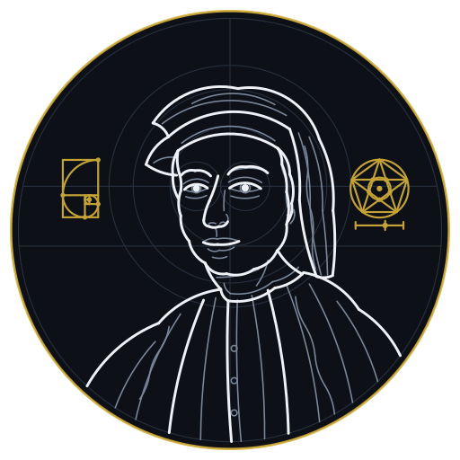

:site_title: Leonardo Pisano (Fibonacci)

.. container:: author-overline

   semantic digital archive • the works of

===========================
Leonardo Pisano (Fibonacci)
===========================

**Leonardo Pisano** (*c.* 1170 – *c.* 1245), remembered as **Fibonacci**, reshaped European mathematics twice over: first by introducing Hindu-Arabic numerals and the golden rabbit recurrence in *Liber Abbaci* (1202/1228), and then by uniting Euclidean construction with Pisan land-surveying, Archimedean circle bounds, and Platonic polyhedra in *Practica Geometriae* (1220).

Books in This Collection
------------------------

.. container:: home-book-hero

   .. container:: home-book-thumb

      .. image:: _static/figures/dodecahedron_golden_chord.svg
         :alt: Fibonacci Practica Geometriae Distinctio VI golden ratio division and dodecahedron chord
         :target: practica_geometriae/index.html

   .. container:: home-book-body

      .. rubric:: Latin & English Edition · 1220 (ed. Boncompagni, 1862) · 8 Distinctions · 4 Tracks

      **Practice of Geometry** (*Practica Geometriae*) — Fibonacci's complete eight-distinction treatise on Pisan metrology, Heron's incenter proof, 96-gon circle bounds, field divisions (*De divisione camporum*), and regular polyhedra in a sphere, paired with **10 calibrated interactive SVG plates**.

      .. container:: home-actions

         * :doc:`Open Practica Geometriae → <practica_geometriae/index>`
         * :doc:`Distinctio I (Pisan Metrology) → <practica_geometriae/dist_01/index>`
         * :doc:`Symbolic Demos → <demos/index>`

.. container:: home-book-hero no-thumb

   .. container:: home-book-body

      .. rubric:: Latin & English Edition · 1202 / 1228 (ed. Boncompagni, 1857) · Chapters I & XII · 4 Tracks

      **The Book of Calculation** (*Liber Abbaci*) — The historic opening chapter on the nine Indian figures and zero (*zephirum*) paired with Chapter XII.7's famous rabbit problem (*Quot paria coniculorum*), tracing the recurrence :math:`F_{n+1} = F_n + F_{n-1}` and its convergence to :math:`\phi`.

      .. container:: home-actions

         * :doc:`Open Liber Abbaci → <liber_abbaci/index>`
         * :doc:`Chapter I (Nine Indian Figures) → <liber_abbaci/cap_01/index>`
         * :doc:`Chapter XII.7 (The Rabbit Problem) → <liber_abbaci/cap_12/index>`

Key Features
------------

.. container:: home-feature-grid

   .. container:: home-feature-card

      **Medieval Latin & English Scriptorium**

      Read Boncompagni's critical Latin editions (1857, 1862) side-by-side with direct English translation, executive summaries, and historical commentary across every distinction and chapter.

   .. container:: home-feature-card

      **From Pisan Surveying to Platonic Solids**

      Follow Fibonacci from *pertica* field mensuration and Euclid's lost *On Divisions of Figures* to Hypsicles' Book XIV ratios of the dodecahedron and icosahedron.

   .. container:: home-feature-card

      **Exact Rational & Radical Verifications**

      Verify Heron's proof on :math:`(13, 14, 15)`, Fibonacci's 96-gon :math:`\pi` bounds, Ptolemy's quartic, and rabbit-sequence convergence to :math:`\phi` in :doc:`demos/index`.

Reference & Project
-------------------

.. container:: home-columns

   .. container:: home-col

      .. rubric:: Scholarly Apparatus

      * :doc:`People <practica_geometriae/people/index>` — Profiles of Leonardo Pisano, Baldassarre Boncompagni, Michael Scot, Euclid, and Archimedes
      * :doc:`Bibliography <practica_geometriae/bibliography>` — Boncompagni *Scritti* (1857, 1862) and medieval manuscript witnesses
      * :doc:`Concordance <practica_geometriae/concordance>` & :doc:`Glossary <practica_geometriae/glossary>` — Cross-corpus links and Pisan metrology lexicon

   .. container:: home-col

      .. rubric:: About This Project

      * :doc:`About <about/index>` — Editorial scope, symbolic grounding, and source provenance
      * :doc:`Using This Edition <usage/index>` — Multi-track switching and navigation guide
      * :doc:`Log <log/index>` & :doc:`Modules <modules/index>` — Development journal and Python API reference

.. toctree::
   :maxdepth: 2
   :hidden:

   practica_geometriae/index
   liber_abbaci/index
   practica_geometriae/people/index
   practica_geometriae/bibliography
   about/index
   usage/index
   demos/index
   log/index
   modules/index
